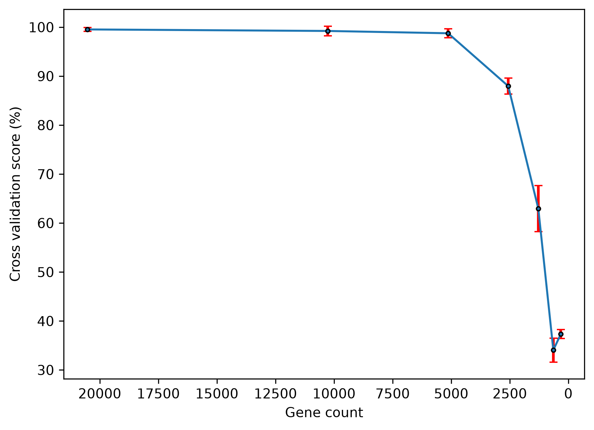

# Research Log
## Aug 26th 2026
### Goal>> 
Understand raw data before analysis
### What i did>>
- Checked for missing data(```print(df.isnull().sum().sum())``` returned 0).
- Found table shape (801 rows x 20532 columns)
- Renamed column "Unnamed: 0" to "Samples"
### Interesting finds>>
- The entire 5th gene expression column sums to 0. In other words none of the sample possess an expression of this gene.

## Aug 27th 2026
### Goal>> 
- Establish a Machine Learning foundation to work off of
### What i did>>
- Investigated cancer distributions
- Make a simple base model
- Test multiple random states to gauge avg accuracy
- Cross validate across 5 divisions. [0.98757764 1.         1.         1.         1.        ]

### Interesting finds>>
- Cancer Types are unevenly distributed. Solution-> use ```stratify``` when building model

| Cancer    | Count        |
|-----------|--------------|
| BRCA | 300 |
| KIRC | 146   |
| LUAD | 141 |
| PRAD | 136   |
| COAD | 78   |

- Accuracy using 4 different random states were averaged to ~99.85%. 

| State | Accuracy |
|-------|----------|
| 42    | 0.994    | 
| 2     | 1.0      | 
| 10    | 1.0      | 
| 123   | 1.0      | 

## Aug 28th 2026
### Goal>> 
- Ranking importance of gene expressions(My definition of its importance is:
average absolute Logistic Regression coefficient across the five cancer classes.)
### What i did>>
- ```model.coef_``` is an array of the Logistic Regression coefficient 
for each gene divided into 5(for each class).
```model.coef_.shape``` = 5x20531
- Used numpy to rank genes according to their importance
### Interesting finds>>

## Aug 29th 2026
### Goal>> 
- Begin the recursion phase--> progressively removing the most important genes
in reasonable chunks at a time.
### What i did>>
- Before starting recursion I removed the top 10% "most influential genes" 
manually to make an early comparison
- Completed a rough gene_removal() function that repeatedly trains, evaluates, 
ranks gene importance, and removes a specified percentage of the 
currently remaining genes until a defined gene-count limit is reached.
- The ```gene_removal()``` function returns a pandas dataframe 
- Encountered the error: ``` C:\Users\tahar\PycharmProjects\My projects\RoughProject\.venv\Lib\site-packages\sklearn\linear_model\_logistic.py:599: ConvergenceWarning: lbfgs failed to converge after 1000 iteration(s) (status=1):
STOP: TOTAL NO. OF ITERATIONS REACHED LIMIT
Increase the number of iterations to improve the convergence (max_iter=1000).
You might also want to scale the data as shown in:
    https://scikit-learn.org/stable/modules/preprocessing.html
Please also refer to the documentation for alternative solver options: ``` from which i learnt that the model couldnt converge within the given iters. Solution-> I learnt to use the ```StandardScaler()``` to rescale the gene expressions. 
- I turned ``` model = LogisticRegression()``` to ``` model = make_pipeline(StandardScaler(),LogisticRegression())``` resulting in 70% decrease in iterations.```(original conversion - array([30], dtype=int32) new conversion- array([9], dtype=int32))```
### Interesting finds>>
- Found that despite removing ~2,000 genes
and cross validating, the successful classifications made by 
the new model didn't experience any significant decrease

| Cross_Division | Old success %<br/>(20533 genes) | New success %<br/>(18478 genes) |
|----------------|---------------------------------|---------------------------------|
| 1              | 0.98757764                      | 0.99378882                      |
| 2              | 1                               | 1                               |
| 3              | 1                               | 1                               |
| 4              | 1                               | 0.99375                         |
| 5              | 1                               | 0.99375                         |
- The difference between adjacent cross validation means seems to have an increasing trend down the table


| Gene count | Cross validation score % | Standard deviation |
|---|--------------------------|---|
|20531.0| 0.997516                 |0.004969|
|18478.0| 0.996258                 |0.003056|
|16425.0| 0.995008                 |0.002496|
|14372.0| 0.990023                 |0.004959|
|12319.0| 0.987523                 |0.005564|
|10266.0| 0.983773                 |0.006365|
|8213.0| 0.980031                 |0.009169|
|6160.0| 0.962547                 |0.014252|
|4107.0| 0.940078                 |0.015092|
|2054.0| 0.881398                 |0.016301|


- significant drop in performance when i progressively halved data

|   Gene count |   Cross validation score |   Standard deviation |
|-------------:|-------------------------:|---------------------:|
|        20531 |                 0.995008 |           0.00249616 |
|        10265 |                 0.992516 |           0.00611111 |
|         5133 |                 0.986266 |           0.00729142 |
|         2567 |                 0.897609 |           0.0117338  |
|         1283 |                 0.680427 |           0.0148685  |
|          641 |                 0.420699 |           0.0189943  |
|          321 |                 0.370784 |           0.014487   |
- The model retained ~90% mean cross-validation accuracy with only 2,567 
of the original 20,531 genes remaining, meaning approximately 
87.5% of genes had been removed.

## Sep 4th 2026
### Goal>> 
- Complete the graph and begin conclusion phase
### What i did>>
- Plotted graph.(Had to reverse x-axis )
- Graph formatting, error bars
- begin project observation, interpretation records.


## Graphed results 


## Observations

|   Gene count | Cross validation score % | Standard deviation | 
|-------------:|-------------------------:|-------------------:|
|        20531 |                  99.5008 |           0.249616 |
|        10265 |                  99.2516 |           0.611111 |
|         5133 |                  98.6266 |           0.729142 |
|         2567 |                  89.7609 |            1.17338 |
|         1283 |                  68.0427 |            1.48685 |
|          641 |                  42.0699 |            1.89943 |
|          321 |                  37.0784 |             1.4487 |

- As gene count is progressively halved/reduced it is apparent that the prediction accuracy(cross val score) 
shows a declining trend.
- Discarding 75% of the top influential genes in decision-making still produces a near 99% accuracy.
- Accuracy takes a significant hit after approximately 87.5% of the genes had been removed(from 98.6% to 89.8%).
- The standard deviation generally increases as gene count is lowered.
The std peaks at 1.89943 where the gene count is 641.

## Results Interpretation
- Overall the slope of the graph steadily increases(with the sole exception being between the last two points)
suggesting the predictive performance of the model clearly drops at an increasing rate with reduction of influential genes.
- The standard deviation increasing points towards increased variability between the 5 folds 
of the cross_val_score. In other words there is an increase in the inconsistency of the prediction accuracy between the 5 folds.

## Conclusion
#### The results can be summarized as the following:
- The model can predict cancer types with extremely high accuracy when trained on the complete data set.
- The fewer influential genes the model is trained on, the lower its accuracy.
- The model maintained a high level of performance despite substantial feature reduction. Even after approximately 87.5% of the original gene features were removed, the model achieved a mean cross-validation accuracy of approximately 89.8%.
- However, performance declined sharply at lower gene counts, falling to approximately 68.0% with 1,283 genes and 37.1% with 321 genes.
- The standard deviation of the cross-validation scores generally increased as the number of genes decreased, suggesting greater variability in predictive performance between the five folds.
20,531 genes → 2,567 genes
99.50% cross-validation accuracy → 89.76% cross-validation accuracy
To conclude, the model shows that a relatively small set of influential genes can be sufficient to classify the type of cancer patients have and removing too many of these genes negatively impacts performance and adds to variability.


Source : https://archive.ics.uci.edu/dataset/401/gene+expression+cancer+rna-seq